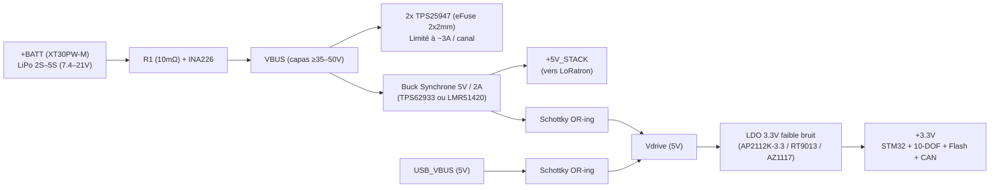

# Larpotron v2 — Point de situation (30 × 60 mm)

> [!summary] Objectif v2
> Passer le **Larpotron** de `25 × 50 mm` (1250 mm²) à **`30 × 60 mm` (1800 mm², +44 %)** pour standardiser le format mécanique avec le **LoRatron** (`ESP32-S3-MINI-1U` + `LR1121`), corriger les défauts identifiés sur la v1 et fiabiliser l’alimentation, l’étage pyro et le workflow de debug autonome (ST-Link + agent).

---

## 1. Décisions d’architecture validées

| Sujet | Décision retenue pour la v2 | Justification |
| :--- | :--- | :--- |
| **Format & Mécanique** | `30 × 60 mm`, 4 trous **M2.5 aux 4 coins pile sur le bord** | Entraxe figé pour le stacking avec le LoRatron. |
| **Stackup** | **4 couches** (`F.Cu` / `In1.Cu` GND continu / `In2.Cu` +3.3V ou GND / `B.Cu`) | Simple face SMD si ça passe proprement au placement, sinon double face léger. |
| **Alimentation 5 V + 3.3 V** | **Buck synchrone wide-Vin → 5 V (2 A)** + **LDO 3.3 V faible bruit** | Un LDO 5 V depuis la LiPo cramerait (~3 W en 3S avec ESP32-S3 + LR1121). Le Buck 5 V alimente le LoRatron et le LDO 3.3 V garde le 10-DOF propre (zéro ripple). |
| **Pyro (2 canaux)** | **2× `TPS25947`** (eFuse 2×2 mm) + connecteurs **JST-SH 2-pin** (burst) | Plus petit que `FDC6326L`, piloté direct en GPIO 3.3 V (`EN/UVLO`), limite de courant réglable (ex. 3 A) + protection court-circuit & thermique. |
| **Connecteur batterie** | **`AMASS XT30PW-M`** horizontal sur un unique côté | Aucune réf XT30 horizontale PCB n'est stockée en natif chez Mouser + DigiKey + LCSC à la fois. `XT30PW-M` reste dispo chez LCSC, TME et shops FPV. |
| **USB-C** | **Horizontal (`USB4105-GF-A`)** par défaut *(vertical à arbitrer)* | Vertical fait gagner ~4–5 mm mais bloque le branchement si le LoRatron est stacké au-dessus et subit plus de bras de levier au bureau. |
| **CAN & Quartz HSE** | **Pas de quartz HSE** (CAN optionnel / 500 kbps max) | HSI16 suffit en pratique à 500 kbps avec un `SJW` large ; libère `PF0`/`PF1` et évite des composants inutiles. `R18` (120 Ω) en DNP par défaut. |
| **Debug / Agent de nuit** | **ST-Link permanent** (`SWCLK`, `SWDIO`, `NRST`, + **`SWO`**, `3V3`, `GND`) + **bouton `BOOT0`** | Permet à un agent de flasher, resetter et logger l’IMU/gyro toute la nuit sans toucher à la carte (USB-C pour log/alim + ST-Link pour flash/debug). |

---

## 2. Architecture d’alimentation v2 cible

---

## 3. Ce qui a déjà été corrigé dans le schéma

> [!success] Modifications appliquées et vérifiées (`analyze_schematic.py` : 0 erreur, warnings passés de 15 → 6)
> - [x] **`Power.kicad_sch` — Pinout `J3` aligné sur `J4`** : `J3` a maintenant `Pin 1 = PYRO1_H`, `Pin 2 = GND`, `MP = GND` (identique à `J4`).
> - [x] **`Power.kicad_sch` — `C8` passé en 50 V X7R** : remplacé le `100nF 16V` (`GRM155R71C104KA88D`) sur `+BATT` par `100nF 50V` (`GRM155R71H104KE14D`, boîtier 0402 conservé).
> - [x] **`Larpotron.kicad_sch` — `R18` (120 Ω CAN) passé en `DNP`** : évite de charger un bus CAN multi-nœuds par défaut.
> - [x] **`Larpotron.kicad_sch` — 9 marqueurs `No-Connect` ajoutés sur `U6`** : `PC13`, `PC14`, `PC15`, `PB2`, `PC6`, `PA10`, `PB3`, `PB4`, `PB6` (tous les warnings `NT-001` résolus).

---

## 4. À faire dans KiCad — Schéma (v2)

> [!todo] Changements nécessitant l’éditeur KiCad (nouveaux symboles / sous-circuits)
> - [ ] **Bloc Alimentation (`Power.kicad_sch`)** :
>   - [x] Ajouter le **Buck synchrone 5 V / 2 A** (ex. `TPS62933` en SOT-563 ou `LMR51420` en SOT-23-6) sur `VBUS` → `+5V`.
>   - [x] Connecter `+5V` vers la diode `D4` (OR-ing avec `USB_VBUS` via `D3`) pour alimenter le LDO 3.3 V à 5 V max.
>   - [x] Optionnel : remplacer `U1` (`AZ1117CH-3.3` SOT-223) par un LDO 3.3 V faible bruit plus compact (`AP2112K-3.3` ou `RT9013-33GB` SOT-23-5).
>   - [x] Vérifier la tension des bulk caps sur `+BATT` / `VBUS` (`C7`, `C4` sont en 25 V : OK jusqu’en 5S, passer en 35 V si 6S envisagé).
>   - [ ] Ajouter les `PWR_FLAG` manquants (`+BATT`, `GND`, `VBUS`, `Vdrive`, `USB_VBUS`) pour un ERC 100 % propre.
> - [ ] **Bloc Pyro (`Power.kicad_sch`)** :
>   - [ ] Remplacer `IC3` et `IC4` (`FDC6326L`) par **2× `TPS25947`** (WSON-10 2×2 mm) :
>     - `EN/UVLO` ← `PYRO1_FIRE` / `PYRO2_FIRE` (avec pull-down 100 kΩ vers GND).
>     - Résistance `R_ILIM` dimensionnée pour **~3 A**.
>     - Conserver le circuit de mesure de continuité (`R14`/`R15` 100 kΩ + diviseurs `47k/10k`).
> - [ ] **Debug & Stack (`Larpotron.kicad_sch`)** :
>   - [ ] Ajouter un **bouton poussoir `BOOT0`** entre `PB8` et `+3.3V` (pull-down `R2` 10 kΩ déjà présent).
>   - [ ] Optionnel : passer `J2` (SWD) en 6 pins pour sortir **`SWO` (`PB3`)** (retirer le `no_connect` sur `PB3` si routé).
>   - [ ] Ajouter le **connecteur de stacking vers le LoRatron** : `+5V`, `GND` (×2+), bus choisis (`UART` / `SPI2` / `I2C1`), `NRST` et GPIOs utiles.
>   - [ ] Ajouter une **TVS dédiée sur `USB_VBUS`** (et optionnellement `PESD2CAN` sur CAN si populé un jour).
>   - [ ] Trancher **USB-C horizontal (`USB4105-GF-A`) vs vertical (THT 4 pattes)** selon l’ordre d’empilement avec le LoRatron.

---

## 5. À faire dans KiCad — Layout PCB v2 (`30 × 60 mm`)

> [!todo] Règles de placement & routage pour une v2 propre
> - [ ] **Contour & Mécanique** : passer `Edge.Cuts` à **`30 × 60 mm`** avec les 4 trous M2.5 aux 4 coins pile sur le bord (identiques au LoRatron).
> - [ ] **Zonage en 3 blocs sur les 60 mm** :
>   1. **Zone Puissance / Pyro** (bord `XT30PW-M` horizontal) : `J1`, `R1`/`U2` (`INA226`), Buck 5 V, `TPS25947` ×2, `J3`/`J4`.
>   2. **Zone Numérique** (centre) : `U6` (`STM32G491`), `IC2` (Flash), `U5` (CAN), `J6` (USB-C), connecteur stack.
>   3. **Zone 10-DOF** (extrémité opposée à la puissance) : `U3` (`ICM-45686`), `U4` (`BMP581`), `IC1` (`MMC5983MA`) — loin des forts courants et de la chaleur du Buck.
> - [ ] **Corriger les défauts PCB v1** :
>   - [ ] Supprimer le chevauchement de courtyard `J1` ↔ `C7` (`PM-001`).
>   - [ ] Éloigner tous les ICs à **≥ 1.0–1.5 mm** du bord (`IC1` était à 0.30 mm, `IC2` à 0.25 mm).
>   - [ ] Rapprocher le condensateur de découplage `C19` de `U2` (`INA226`, était à 6.7 mm → < 2 mm).
>   - [ ] Ajouter **3 fiducials** par face SMD (`FD-001`).
>   - [ ] Ajouter des **points de test** (`+5V`, `+3.3V`, `VBUS`, `GND`, `NRST`, `SWDIO`, `SWCLK`).
>   - [ ] Augmenter les **vias thermiques** sous `U6` (≥ 15) et `IC2` (≥ 9) et sortir le via-in-pad de `J2:MP`.
>   - [ ] Mettre **≥ 2 vias GND** directement sur `D1` (`PRTR5V0U2X`).
>   - [ ] **Plan & EMC** : garder `In1.Cu` en GND plein sans aucune piste, utiliser `In2.Cu` en plan `+3.3V` (ou second GND), et poser un **via de stitching GND** à chaque transition de couche des horloges/SPI (`SCK1`, `SPI2_SCK`, `SWCLK`, `IMU_CLKIN`).
> - [ ] **Évaluer simple face vs double face** une fois les gros blocs posés sur `30 × 60 mm`.

---

## 6. Mini-BOM des nouveaux composants à sourcer

| Fonction | Référence suggérée | Boîtier | Disponibilité |
| :--- | :--- | :--- | :--- |
| **Buck 5 V / 2–3 A** | TI `TPS62933DRLR` *(ou `LMR51420`)* | SOT-563 *(ou SOT-23-6)* | Mouser / DigiKey / LCSC |
| **LDO 3.3 V faible bruit** *(optionnel)* | `AP2112K-3.3TRG1` ou `RT9013-33GB` | SOT-23-5 | Mouser / DigiKey / LCSC |
| **Smart Switch Pyro (×2)** | TI `TPS259470LRPWR` *(ou variante `TPS25947`)* | WSON-10 (2 × 2 mm) | Mouser / DigiKey / LCSC |
| **Capa `+BATT` 100 nF 50 V (`C8`)** | Murata `GRM155R71H104KE14D` | 0402 | Mouser / DigiKey / LCSC |
| **Batterie XT30 horizontal** | Amass `XT30PW-M` (`XT30PW-M30.G.Y`) | THT 90° | LCSC / TME / shops FPV |
| **Bouton `BOOT0`** | Mini tact SMD 3×2.5 mm ou 3×4 mm (ex. `TS-1187A` / `EVQ-P7A01P`) | SMD | Mouser / DigiKey / LCSC |
